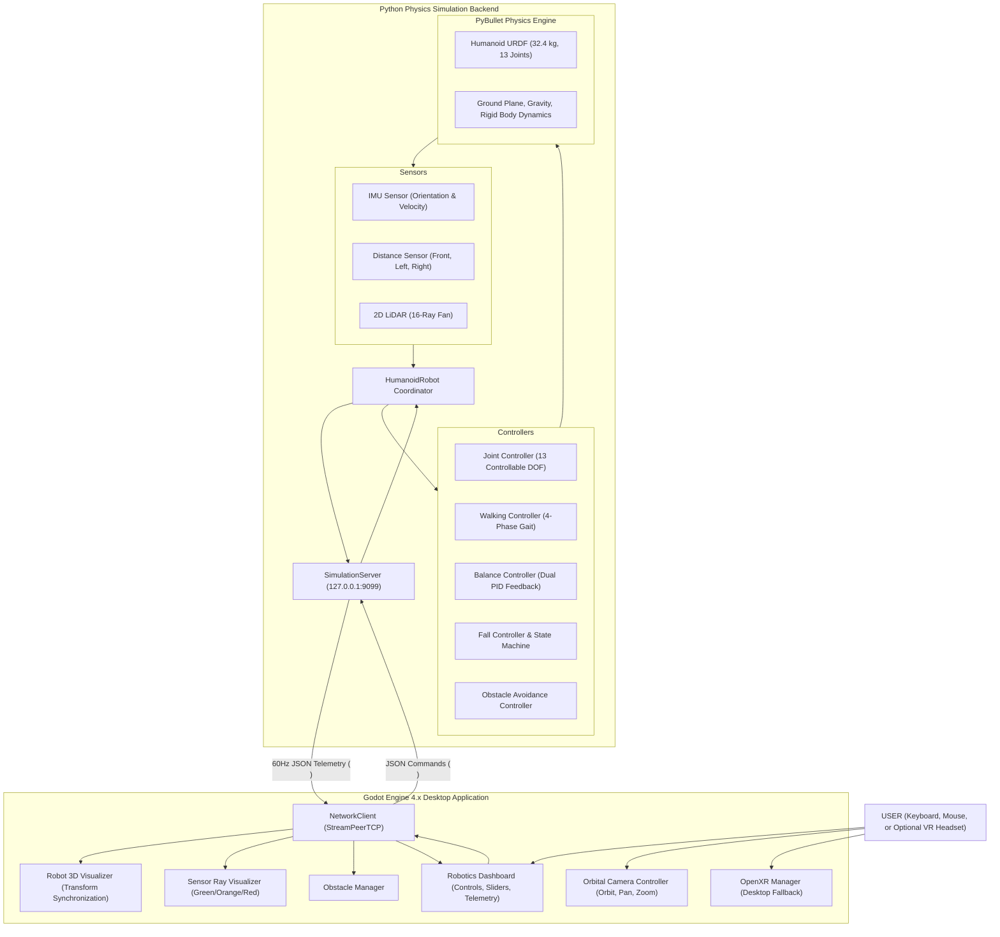

# VR Humanoid Robot Simulator

### Academic Engineering End Semester Examination (ESE) Project
**Developed by:** Aryan & Vilas  
**Department:** Robotics / Virtual Reality / Engineering Simulation  

[](https://www.python.org/)
[](https://pybullet.org/)
[](https://godotengine.org/)
[](https://www.blender.org/)
[](tests/)
[](tests/run_scenarios.py)
[](https://www.khronos.org/openxr/)

---

## 1. Project Overview

The **VR Humanoid Robot Simulator** is a complete, physically simulated robotics application designed for evaluating bipedal locomotion, dynamic posture balance, individual joint servoing, external disturbance recovery, and autonomous obstacle avoidance.

The system uses a strictly decoupled client-server architecture:
- **Physics Simulation (Backend):** Built with **PyBullet** in Python. Responsible for rigid body dynamics, joint motor torque, ground contact friction, simulated IMU, distance ray sensors, PID balance stabilization, and gait trajectory generation.
- **3D Visualization & Interaction (Frontend):** Built with **Godot Engine 4.x**. Provides a modern 3D robotics laboratory scene, orbital camera inspection, comprehensive telemetry dashboards, interactive joint sliders, and optional **OpenXR VR** support with full **desktop keyboard/mouse fallback**.
- **Communication:** Non-blocking TCP sockets transmitting newline-delimited JSON commands and continuous 60 Hz telemetry.

> [!IMPORTANT]
> **No VR headset is required to run or evaluate this project.** The application runs as a standalone desktop program using standard keyboard and mouse. OpenXR VR mode activates automatically if a compatible headset is detected.

---

## 2. Key Capabilities

1. **Bipedal Locomotion (Walking):**
   - 4-phase alternating gait cycle (Left Swing $\to$ Weight Shift $\to$ Right Swing $\to$ Weight Shift).
   - Counterbalanced arm swinging to cancel rotational momentum.
   - Smooth cycloidal trajectories with ground clearance and adjustable speed ($0.2\times$ to $1.5\times$).
2. **Feedback Posture Balance (Dual PID):**
   - Simulated IMU monitoring roll, pitch, and yaw rates.
   - Dual PID feedback loops controlling sagittal (ankle/hip pitch) and lateral (hip roll) corrections.
   - Center of Mass (COM) computation and support polygon stability classification.
3. **Individual Joint Control Panel:**
   - Real-time sliders for 13 controllable degrees of freedom (neck, shoulders, elbows, hips, knees, ankles).
   - Live target angle vs. current angle telemetry in degrees.
4. **Disturbance & Fall Dynamics:**
   - 8-state machine: `IDLE`, `STANDING`, `WALKING`, `BALANCING`, `UNSTABLE`, `RECOVERING`, `FALLING`, `FALLEN`.
   - External push disturbances: Small ($60\ \text{N}$), Medium ($160\ \text{N}$), and Strong ($350\ \text{N}$).
   - Natural gravity-driven falling and one-click physics reset.
5. **Raycast Obstacle Detection & Avoidance:**
   - 3-channel ray tests (Front, Left at $+35^\circ$, Right at $-35^\circ$) up to $3.5\ \text{m}$.
   - Planar 2D LiDAR fan simulation (16 rays over $120^\circ$).
   - Autonomous steering logic that turns toward the clearer path or halts if trapped.
   - Dynamic 3D in-engine obstacle placement (cubes, cylinders, walls) with visible raycast lines.
6. **A* Optimal 2D Path Planning & Navigation:**
   - 8-connected $A^*$ grid path planner with $0.52\text{ m}$ obstacle dilation and line-of-sight shortcut smoothing.
   - Interactive 3D click-to-floor target selection (`_unhandled_input` raycasting with horizontal plane intersection).
   - Visual 3D pulsing goal beacon (vertical cyan pillar + torus) and real-time optimal path ribbon (`ImmediateMesh`).
   - Closed-loop waypoint tracking and arrival detection.
7. **Stand-in-Place Recovery Mechanism:**
   - Restores the fallen robot upright at its **exact current $(X, Y)$ arena position and heading**, without teleporting back to the origin.
   - Resets base velocities and motor PIDs for stable standing.
8. **Automated Robotics Experiments Suite (6 Benchmarks):**
   - Scenario 1: Basic Walking Test (1.0m traversal with pitch stability).
   - Scenario 2: Balance & Disturbance Recovery ($80\text{ N}$ impulse push absorption).
   - Scenario 3: Push & Fall Dynamics ($60\text{ N}, 160\text{ N}, 350\text{ N}$ multi-stage impact).
   - Scenario 4: Reactive Obstacle Course Bypass (zero collisions).
   - Scenario 5: Uneven Terrain Incline Ramp Traversal.
   - Scenario 6: Upper-Limb Pick & Place Manipulation with physical object grasping constraint.

---

## 3. System Architecture



---

## 4. Project Directory Structure

```text
VR-Humanoid-Robot-Simulator/
│
├── README.md                  # Project overview and instructions
├── requirements.txt           # Python dependencies
├── pytest.ini                 # Pytest configuration
├── run_simulator.bat          # One-click Windows launcher
├── run_backend.bat            # Backend-only launch script
├── run_godot.bat              # Godot-only launch script
├── run_tests.bat              # Test suite execution script
│
├── python/                    # Python Physics Backend
│   ├── main.py                # Main backend entry point
│   ├── robot.py               # Humanoid robot coordinator
│   ├── simulation.py          # PyBullet physics simulation world
│   │
│   ├── controllers/
│   │   ├── joint_controller.py      # Individual joint actuation and limits
│   │   ├── walking_controller.py    # 4-phase walking gait generator
│   │   ├── balance_controller.py    # Feedback balance and dual PID
│   │   ├── fall_controller.py       # Fall detection and state machine
│   │   ├── obstacle_avoidance.py    # Reactive steering avoidance
│   │   ├── navigation_controller.py # A* optimal path planning and waypoint tracking
│   │   └── experiment_manager.py    # 6 automated benchmark robotics scenarios
│   │
│   ├── sensors/
│   │   ├── imu_sensor.py            # Simulated IMU (roll, pitch, yaw)
│   │   ├── distance_sensor.py       # 3-ray distance sensor
│   │   └── lidar_sensor.py          # 2D planar LiDAR sensor
│   │
│   ├── communication/
│   │   ├── server.py                # Non-blocking TCP socket server
│   │   ├── protocol.py              # JSON schema parser and serializer
│   │   └── telemetry.py             # Telemetry packet builder
│   │
│   ├── models/
│   │   └── humanoid.urdf            # Complete robot kinematics and dynamics
│   │
│   └── utils/
│       ├── pid.py                   # PID controller with anti-windup
│       └── math_utils.py            # Center of mass and support polygon
│
├── godot/                     # Godot 4.x Desktop Application
│   ├── project.godot          # Godot project configuration
│   ├── scenes/
│   │   └── main.tscn          # Main 3D laboratory scene
│   ├── scripts/
│   │   ├── main.gd                  # Root scene coordinator
│   │   ├── network_client.gd        # TCP client and JSON parser
│   │   ├── camera_controller.gd     # Orbital 3D camera controller
│   │   ├── robot_visualizer.gd      # 3D link transform synchronization
│   │   ├── obstacle_manager.gd      # Dynamic 3D obstacle spawning
│   │   ├── ui_controller.gd         # Dashboard UI and joint sliders
│   │   └── build_scene.gd           # Headless scene generator script
│   ├── xr/
│   │   └── xr_manager.gd            # OpenXR initializer with desktop fallback
│   ├── materials/             # PBR materials (torso, limbs, visor, floor)
│   └── models/                # GLTF/GLB models exported from Blender
│
├── blender/                   # Blender Modeling Assets
│   ├── generate_assets.py     # Script to generate .blend and .glb files
│   ├── humanoid.blend         # Humanoid robot model file
│   └── environment.blend      # Robotics lab environment file
│
├── docs/                      # Technical Documentation
│   ├── architecture.md        # Comprehensive architecture breakdown
│   ├── installation.md        # Installation and usage instructions
│   ├── algorithms.md          # Walking, PID, and avoidance algorithms
│   └── testing.md             # Validation report and test results
│
└── tests/                     # Automated Test Suite (pytest) & Scenarios
    ├── test_joints.py         # Joint limits and actuation tests
    ├── test_physics.py        # Dynamics, gravity, push tests, and stand-in-place
    ├── test_balance.py        # PID, gait, and avoidance logic tests
    ├── test_navigation.py     # A* optimal path planning & steering direction
    ├── test_professional_edition.py # Multi-directional gait, CoM, & 6 experiments
    ├── test_communication.py  # JSON protocol and telemetry tests
    ├── test_integration.py    # Live TCP socket handshake tests
    └── run_scenarios.py       # Physics scenario benchmark execution runner
```

---

## 5. Quickstart Guide

### 1. Requirements
- Python 3.10+ (tested on Python 3.13)
- Godot 4.x (portable 64-bit executable installed)
- Dependencies: `pip install -r requirements.txt`

### 2. Launching the Simulator
To run both the Python physics backend and the Godot desktop interface with a single command, execute:
```cmd
run_simulator.bat
```

Alternatively, launch the two components in separate terminals:
```bash
# Terminal 1: Python Physics Backend
python python/main.py

# Terminal 2: Godot 4.x Desktop Visualizer
godot --path godot
```

### 3. Running Unit Tests and Physics Verification Scenarios
```bash
# Run full unit and integration test suite (26 tests)
pytest tests/ -v

# Run the 6 automated robotics physics scenarios
python tests/run_scenarios.py
```
All 26 unit tests and all 6 physical scenario benchmarks pass deterministically.

---

## 6. Development Progress & Completed Phases

| Phase | Description | Status |
|---|---|---|
| **Phase 0** | Environment Setup (Python 3.13, PyBullet 3.2.7, Godot 4.x, Blender 4.2 LTS) | **COMPLETE** |
| **Phase 1** | Humanoid URDF Model (13 Controllable Joints, Realistic Mass & Inertia) | **COMPLETE** |
| **Phase 2** | Individual Joint Movement Controller (Position/Velocity Motor Control) | **COMPLETE** |
| **Phase 3** | 4-Phase Bipedal Walking Controller with Arm Synchronization & Speed Tuning | **COMPLETE** |
| **Phase 4** | Dual PID Feedback Balance System with COM & Support Polygon Monitoring | **COMPLETE** |
| **Phase 5** | Physical Disturbances ($60\ \text{N}, 160\ \text{N}, 350\ \text{N}$), Fall Detection & FSM | **COMPLETE** |
| **Phase 6** | Simulated Raycast Distance Sensor & Reactive Obstacle Avoidance | **COMPLETE** |
| **Phase 7** | Godot 3D Robotics Laboratory & Orbital Camera System | **COMPLETE** |
| **Phase 8** | Bidirectional TCP Socket Server & Real-time Telemetry Synchronization | **COMPLETE** |
| **Phase 9** | OpenXR VR Subsystem with Graceful Desktop Fallback | **COMPLETE** |
| **Phase 10** | Automated Test Suites (pytest), Technical Documentation & Blender Assets | **COMPLETE** |
| **Phase 11** | Professional Edition: 6 Robotics Experiments Suite & Live Analytics Telemetry | **COMPLETE** |
| **Phase 12** | A* Optimal Path Planning & 3D Interactive Click-to-Floor Goal Navigation | **COMPLETE** |
| **Phase 13** | Stand-In-Place Recovery & Closed-Loop Turning Stabilization | **COMPLETE** |

---

## 7. License & Academic Attribution
Developed as an End Semester Examination engineering project by **Aryan & Vilas**.  
Repository: [https://github.com/aryangadhe/ARVR-ese](https://github.com/aryangadhe/ARVR-ese)  
All technologies used (Python, PyBullet, Godot, Blender, NumPy) are open-source and free for academic and research use.

