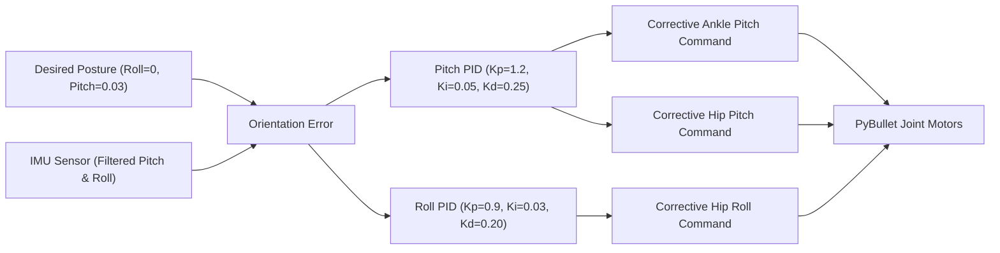
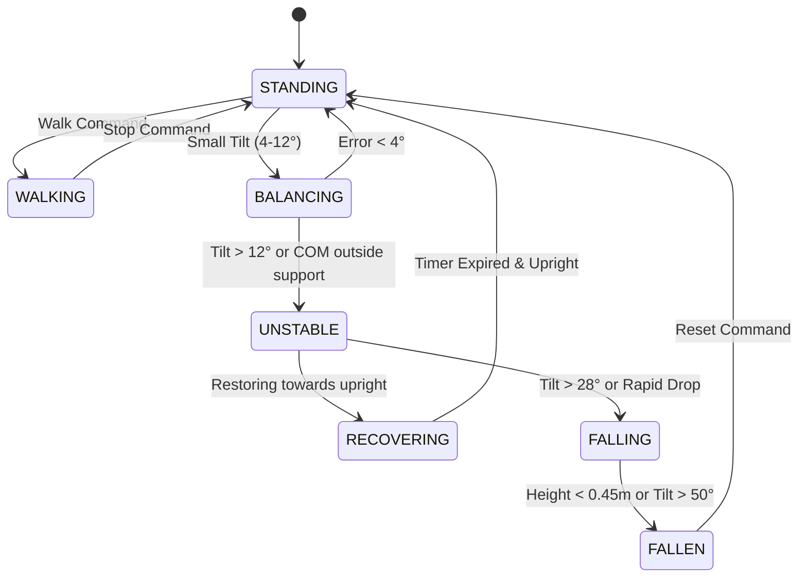

# Robotics Simulation Algorithms

## VR Humanoid Robot Simulator
**Academic Engineering End Semester Examination (ESE) Project**  
**Authors:** Aryan & Vilas  

---

## 1. Bipedal Walking Gait Generation

The walking controller uses an analytical harmonic gait generator structured into 4 discrete sequential phases per cycle:

### 1.1 The 4-Phase Walking Cycle
1. **Phase 1: Left Swing & Right Stance**
   - Left leg lifts and swings forward ($T \in [0.0, 0.25]$).
   - Left knee bends to provide vertical ground clearance.
   - Right leg supports robot weight.
   - Right arm swings forward to counterbalance the angular momentum of the swinging left leg.
2. **Phase 2: Weight Shift (Left Transition)**
   - Torso rolls laterally over stance foot ($T \in [0.25, 0.50]$).
   - Left foot makes flat ground contact.
   - Weight transfers onto the left leg.
3. **Phase 3: Right Swing & Left Stance**
   - Right leg lifts and swings forward ($T \in [0.50, 0.75]$).
   - Right knee bends for ground clearance.
   - Left leg provides support.
   - Left arm swings forward to counterbalance the swinging right leg.
4. **Phase 4: Weight Shift (Right Transition)**
   - Torso rolls laterally over stance foot ($T \in [0.75, 1.00]$).
   - Right foot makes ground contact.
   - Full cycle repeats.

### 1.2 Mathematical Formulation
For gait phase angle $\theta(t) = \omega \cdot t$ where $\omega = \frac{2\pi}{T_{\text{cycle}}} \cdot v_{\text{speed}}$:

$$\text{Left Hip Pitch}(t) = \theta_{\text{nominal}} - A_{\text{hip}} \sin(\theta) + \text{bias}_{\text{turn}}$$
$$\text{Left Knee Pitch}(t) = \theta_{\text{knee\_nominal}} + A_{\text{knee}} \max(0, \sin(\theta))$$
$$\text{Right Hip Pitch}(t) = \theta_{\text{nominal}} + A_{\text{hip}} \sin(\theta) - \text{bias}_{\text{turn}}$$
$$\text{Right Knee Pitch}(t) = \theta_{\text{knee\_nominal}} + A_{\text{knee}} \max(0, -\sin(\theta))$$
$$\text{Lateral Roll Offset}(t) = A_{\text{roll}} \cos(\theta)$$
$$\text{Arm Swing}(t) = \pm A_{\text{arm}} \sin(\theta)$$

---

## 2. Feedback Balance Control System (Dual PID)

To maintain an upright posture under static and dynamic loading, the robot employs two independent feedback loops:

### 2.1 PID Formulation with Anti-Windup
The continuous control signal $u(t)$ is calculated as:
$$u(t) = K_p \cdot e(t) + K_i \int_0^t e(\tau)\,d\tau + K_d \frac{de(t)}{dt}$$

Where:
- $e_{\text{pitch}}(t) = \theta_{\text{pitch\_desired}} - \theta_{\text{pitch\_measured}}$
- $e_{\text{roll}}(t) = \theta_{\text{roll\_desired}} - \theta_{\text{roll\_measured}}$
- **Anti-Windup:** The integral accumulator is saturated within $\pm 0.15\ \text{rad}$ to prevent overshoot after prolonged tilt.
- **Derivative Filter:** A first-order low-pass filter ($\alpha = 0.8$) is applied to $\frac{de}{dt}$ to eliminate high-frequency sensor chatter.

### 2.2 Center of Mass (COM) & Support Polygon
Total Center of Mass is computed at each time step using link masses $m_i$ and link world positions $\mathbf{p}_i$:

$$\mathbf{r}_{\text{COM}} = \frac{\sum_{i=1}^{N} m_i \mathbf{p}_i}{\sum_{i=1}^{N} m_i}$$

The support polygon $S \subset \mathbb{R}^2$ is calculated as the convex bounding hull of the left and right foot contact surfaces in the floor plane $(x, y)$.
- **Stability Criterion:** When $(x_{\text{COM}}, y_{\text{COM}}) \in S$ and $|\theta_{\text{tilt}}| < 5^\circ$, the state is classified as **STABLE**.

---

## 3. Fall Detection and State Machine

The robot incorporates an 8-state finite state machine (FSM):

---

## 4. Reactive Obstacle Avoidance

The simulated distance sensor casts 3 rays forward from the upper torso into the world:
1. **Front Ray:** $0^\circ$ forward along local heading (Range: 3.5 m).
2. **Left Ray:** $+35^\circ$ angled to the left.
3. **Right Ray:** $-35^\circ$ angled to the right.

### Decision Matrix

| Front Distance ($d_F$) | Left Distance ($d_L$) vs Right ($d_R$) | Selected Action | Turn Bias | Speed Multiplier |
|---|---|---|---|---|
| $d_F \ge 1.4\ \text{m}$ | Any | **CLEAR** | $0.0$ | $1.0\times$ |
| $0.7\ \text{m} \le d_F < 1.4\ \text{m}$ | $d_L > d_R$ and $d_L > 0.7\ \text{m}$ | **AVOIDING_LEFT** | $-0.75$ | $0.2 + 0.8\frac{d_F - 0.7}{0.7}$ |
| $0.7\ \text{m} \le d_F < 1.4\ \text{m}$ | $d_R > d_L$ and $d_R > 0.7\ \text{m}$ | **AVOIDING_RIGHT** | $+0.75$ | $0.2 + 0.8\frac{d_F - 0.7}{0.7}$ |
| $d_F < 0.7\ \text{m}$ (All blocked) | Both $< 0.7\ \text{m}$ | **EMERGENCY_STOP** | $0.0$ | $0.0$ (Stop) |

