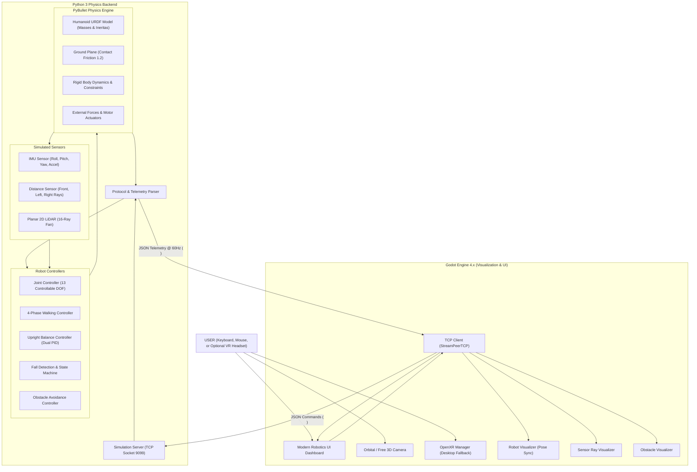

# System Architecture Specification

## VR Humanoid Robot Simulator
**Academic Engineering End Semester Examination (ESE) Project**  
**Authors:** Aryan & Vilas  

---

## 1. Overview
The VR Humanoid Robot Simulator is built on a decoupled, modular client-server architecture. The physical simulation of humanoid dynamics, joint constraints, contact forces, and sensors is strictly driven by the **PyBullet** physics engine via a Python backend. The visual rendering, user interaction, 3D laboratory scene, and optional OpenXR VR interface are handled by **Godot Engine 4.x**.

The source of truth for all physical states (link poses, joint angles, forces, center of mass, and ray sensor hits) resides exclusively in the physics backend.



---

## 2. Component Breakdown

### 2.1 PyBullet Physics Simulation Layer
- **Mode:** Runs in `DIRECT` mode for standard headless backend operation, or in `GUI` mode (`--gui`) for native PyBullet visual debugging.
- **Physics Rate:** Fixed time step $\Delta t = 1/60$ seconds (60 Hz).
- **Gravity:** Standard $-9.81\ \text{m/s}^2$ along the Z-axis.
- **Ground Contact:** High lateral friction ($\mu = 1.2$) and spinning friction ($\mu_s = 0.1$) on feet and floor to eliminate sliding and enable realistic foot traction.
- **Self-Collision:** Enabled via `URDF_USE_SELF_COLLISION` flag.

### 2.2 Robot Articulation and Model Specification
The humanoid robot is defined in `python/models/humanoid.urdf`:
- **Total Mass:** 32.4 kg
- **Height:** ~1.30 m
- **Controllable Joints:** 13 revolute joints with realistic angular limits and velocity/force saturation:
  1. `neck_pitch` (Head tilt: $[-34^\circ, +34^\circ]$)
  2. `left_shoulder_pitch` (Arm swing: $[-103^\circ, +103^\circ]$)
  3. `left_elbow_pitch` (Arm bend: $[0^\circ, +126^\circ]$)
  4. `right_shoulder_pitch` (Arm swing: $[-103^\circ, +103^\circ]$)
  5. `right_elbow_pitch` (Arm bend: $[0^\circ, +126^\circ]$)
  6. `left_hip_roll` (Lateral leg swing: $[-20^\circ, +20^\circ]$)
  7. `left_hip_pitch` (Sagittal leg swing: $[-68^\circ, +68^\circ]$)
  8. `left_knee_pitch` (Knee flex: $[0^\circ, +126^\circ]$)
  9. `left_ankle_pitch` (Foot tilt: $[-40^\circ, +40^\circ]$)
  10. `right_hip_roll` (Lateral leg swing: $[-20^\circ, +20^\circ]$)
  11. `right_hip_pitch` (Sagittal leg swing: $[-68^\circ, +68^\circ]$)
  12. `right_knee_pitch` (Knee flex: $[0^\circ, +126^\circ]$)
  13. `right_ankle_pitch` (Foot tilt: $[-40^\circ, +40^\circ]$)

### 2.3 Network Communication Protocol
Communication occurs over a loopback TCP socket (`127.0.0.1:9099`). Messages are JSON-encoded strings terminated with a newline (`\n`) character.

#### Example Commands (Godot → Python)
```json
{"type": "command", "action": "walk", "speed": 0.6}
{"type": "command", "action": "stop"}
{"type": "command", "action": "reset"}
{"type": "joint_command", "joint": "neck_pitch", "target_deg": 15.0}
{"type": "push", "magnitude": 160.0, "direction": "forward", "duration": 0.15}
{"type": "spawn_obstacle", "obstacle_type": "cube", "position": [1.8, 0.0, 0.4]}
```

#### Example Telemetry (Python → Godot @ 60 Hz)
```json
{
  "type": "telemetry",
  "timestamp": 1732103400.125,
  "state": "WALKING",
  "fall_count": 0,
  "balance": "STABLE",
  "roll": 0.4,
  "pitch": 1.8,
  "yaw": -0.2,
  "position": [0.45, -0.02, 0.82],
  "center_of_mass": [0.46, -0.01, 0.74],
  "walking": {"active": true, "phase": "LEFT_SWING", "speed": 0.6},
  "sensors": {
    "front_distance": 2.84,
    "left_distance": 3.50,
    "right_distance": 3.50,
    "min_distance": 2.84
  },
  "joints": { ... },
  "links": {
    "torso": {"position": [...], "orientation": [...]},
    "left_foot": {"position": [...], "orientation": [...]},
    ...
  },
  "obstacles": [ ... ]
}
```

### 2.4 Godot 4.x Client & OpenXR Architecture
- **Coordinate Conversion:** Maps PyBullet coordinates (Z-up, X-forward, Y-left) to Godot 3D coordinates (Y-up, -Z forward, +X right):
  $$x_{\text{godot}} = -y_{\text{pb}}, \quad y_{\text{godot}} = z_{\text{pb}}, \quad z_{\text{godot}} = -x_{\text{pb}}$$
- **Visual Synchronization:** Each link mesh transform is updated directly from PyBullet's world link pose telemetry, eliminating animation discrepancies.
- **OpenXR Support:** If an OpenXR headset is detected at startup, VR mode is enabled automatically. If no headset is connected, it gracefully falls back to the Desktop keyboard/mouse interface.
